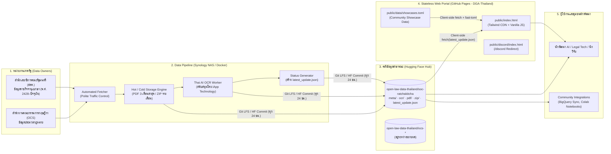
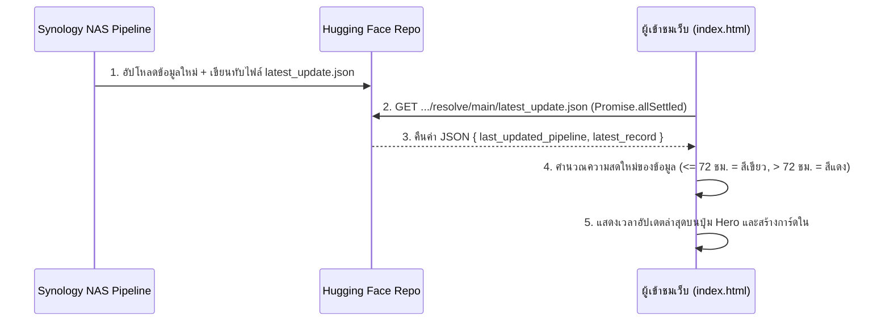

# สถาปัตยกรรมระบบ (System & Web Portal Architecture)

เอกสารนี้อธิบายสถาปัตยกรรมภาพรวมของระบบนิเวศ **Open Law Data Thailand** ตั้งแต่การดึงข้อมูลและประมวลผล OCR หลังบ้าน ไปจนถึงสถาปัตยกรรมเว็บไซต์หน้าบ้าน (`open-law-data-web`) ที่ออกแบบให้ทำงานแบบ **Stateless** และยั่งยืนโดยไม่มีค่าใช้จ่ายเซิร์ฟเวอร์ (Zero-Server Cost)

---

## 1. สถาปัตยกรรมภาพรวมของระบบนิเวศ (End-to-End Ecosystem Topology)

---

## 2. หลักการออกแบบเชิงวิศวกรรม (Core Architectural Principles)

### 2.1 โมเดลตัวกลางลดภาระเซิร์ฟเวอร์ภาครัฐ (Traffic Buffer Model)
ในอดีต นักพัฒนาที่ต้องการข้อมูลกฎหมายจำนวนมากต้องเขียนโปรแกรม Scraping ดึงข้อมูลจากเว็บไซต์ราชการโดยตรง ส่งผลให้เซิร์ฟเวอร์ของหน่วยงานรัฐรับภาระหนัก
* **Open Law Data Thailand** ทำหน้าที่เป็น **Buffer กลาง** ดึงข้อมูลอย่างเป็นระบบด้วยความถี่ต่ำ (Polite Scraping / Direct Transfer) แล้วนำขึ้นโฮสต์บน **Hugging Face Datasets** ซึ่งรองรับการดาวน์โหลดขนาดใหญ่ระดับ Terabyte ได้ฟรี
* นักพัฒนาสามารถดาวน์โหลดข้อมูลแบบ Bulk ผ่าน CLI (`hf download`) ได้ทันทีโดยไม่รบกวนระบบของหน่วยงานรัฐ

### 2.2 กลยุทธ์การจัดเก็บข้อมูล Hot/Cold Storage บน Git LFS
เนื่องจากเอกสารราชกิจจานุเบกษามีจำนวนมากกว่า **1.34 ล้านไฟล์ (170GB+)** การเก็บไฟล์ทั้งหมดเป็นไฟล์เดี่ยวใน Git Repository จะทำให้เกิดปัญหา **Git Index Bloat** และไม่สามารถ `git clone` ได้ ทีมงานจึงแบ่งโครงสร้างข้อมูลเป็น 4 โฟลเดอร์หลัก:
1. **`pdf/` (Hot Data — 3 เดือนล่าสุด)**: เก็บไฟล์ PDF รายฉบับ เพื่อให้บอท นักข่าว และหน้าเว็บไซต์สามารถเปิดดูเอกสารประกาศล่าสุดรายวันได้โดยตรงผ่าน URL
2. **`zip/` (Cold Data — ย้อนหลังตั้งแต่ พ.ศ. 2428)**: มัดรวมไฟล์ PDF เก่าที่มีอายุเกิน 3 เดือน บีบอัดเป็นไฟล์ `.zip` รายเดือน (เช่น `zip/1999/1999-01.zip`) ช่วยลดจำนวน Git Objects จากหลักล้านเหลือหลักพัน
3. **`meta/` (Metadata)**: เก็บไฟล์ข้อมูลบรรณานุกรมรายเดือน เพื่อให้สายวิเคราะห์ข้อมูลดาวน์โหลดไปทำสถิติได้อย่างรวดเร็วโดยไม่ต้องโหลดไฟล์ PDF
4. **`ocr/` (Searchable Text)**: เก็บผลลัพธ์จากการแปลงภาพเป็นข้อความด้วย AI OCR ของ **iApp Technology** ในรูปแบบ JSONL แยกตามปี/เดือน สำหรับงาน NLP, RAG และ LLM Training

---

## 3. สถาปัตยกรรมเว็บไซต์หน้าบ้าน (`open-law-data-web`)

คลังข้อมูลนี้ (`github.com/DGA-Thailand/open-law-data`) คือระบบหน้าบ้านที่โฮสต์อยู่บน **GitHub Pages** ภายใต้โดเมน `www.openlawdatathailand.org` (และ `web.openlawdatathailand.org` ในไฟล์ [`CNAME`](../CNAME))

### 3.1 Stateless & Zero-Build Frontend
* **ไม่ต้องมี Backend Server หรือ Database**: หน้าเว็บเป็นไฟล์ Static ล้วนในโฟลเดอร์ [`public/`](../public/)
* **Tech Stack**:
  * **HTML5**: โครงสร้างหลักอยู่ใน [`public/index.html`](../public/index.html)
  * **Tailwind CSS (CDN)**: โหลดผ่าน `https://cdn.tailwindcss.com` พร้อมกำหนด Custom Theme (`thai-blue`, `thai-dark`, `tech-accent`, ฟอนต์ `Prompt`) ใน `<head>`
  * **Phosphor Icons**: โหลดผ่าน `https://unpkg.com/@phosphor-icons/web`
  * **TOML Parser (`fast-toml@0.5.4`)**: โหลดผ่าน `unpkg` สำหรับแปลงไฟล์ `public/data/showcases.toml` เป็น JSON บนเบราว์เซอร์โดยตรง

### 3.2 ระบบตรวจสอบสถานะข้อมูลแบบ Real-time (Stateless Status Trigger)
แทนที่จะมีเซิร์ฟเวอร์คอยเช็กสถานะฐานข้อมูล หน้าเว็บใช้กลไก **Raw File Fetching** (`public/index.html` บรรทัดที่ `914–1130`):

* รายชื่อแหล่งข้อมูลถูกกำหนดไว้ในตัวแปร `sources` Array (`public/index.html#L952-L959`)
* ใช้ `Promise.allSettled()` ดึงข้อมูลจากทุกแหล่งพร้อมกัน หากแหล่งใดแหล่งหนึ่งล้มเหลว แหล่งอื่นจะยังคงแสดงผลได้ตามปกติ
* เกณฑ์ตรวจสอบความสดใหม่ (SLA Freshness Check):
  * หาก `now - latestPipelineDate <= 72 ชั่วโมง`: แสดงจุดสถานะสีเขียวกะพริบ (`bg-green-500 animate-pulse`)
  * หาก `> 72 ชั่วโมง`: เปลี่ยนจุดสถานะเป็นสีแดง (`bg-red-500`) เพื่อเตือนว่า Pipeline อาจหยุดทำงาน
  * หากดึงข้อมูลไม่ได้เลย: เปลี่ยนจุดสถานะเป็นสีเทา (`bg-gray-400`) และแสดงข้อความ `"อัปเดตระบบ: ไม่ทราบสถานะ"`

### 3.3 ระบบแสดงผลผลงานชุมชน (Git-backed Community Showcase)
ส่วนแสดงผลงานนวัตกรรมจากชุมชน (`#showcase`, `public/index.html#L289-L312` และสคริปต์ `L1132-L1224`) ใช้แนวทาง **Git-as-a-CMS**:
1. ข้อมูลผลงานทั้งหมดถูกเก็บในไฟล์ [`public/data/showcases.toml`](../public/data/showcases.toml)
2. เมื่อเปิดหน้าเว็บ ฟังก์ชัน `loadShowcases()` จะดึงไฟล์ `./data/showcases.toml` และแปลงด้วย `toml.parse()`
3. เรียงลำดับรายการโดยให้โปรเจกต์ที่มี `featured = true` ขึ้นก่อน ตามด้วยวันที่ (`date`) จากใหม่ไปเก่า
4. สร้างการ์ด HTML แสดงผลใน `#showcase-grid` และต่อท้ายด้วยการ์ดปุ่มลัด `"มีของดีอย่าเก็บไว้คนเดียว (Submit Project)"` ที่ลิงก์ไปยังหน้าแก้ไขไฟล์บน GitHub

### 3.4 ระบบ CI/CD และการเผยแพร่ (Deployment Pipeline)
ไฟล์เวิร์กโฟลว์ [`.github/workflows/static.yml`](../.github/workflows/static.yml) ทำงานอัตโนมัติเมื่อมีการ Push เข้ากิ่ง `main` (หรือกดรันผ่าน `workflow_dispatch`):
1. Checkout โค้ดด้วย `actions/checkout@v4`
2. ตั้งค่า GitHub Pages ด้วย `actions/configure-pages@v5`
3. อัปโหลดเฉพาะโฟลเดอร์ `public` เป็น Artifact ด้วย `actions/upload-pages-artifact@v3`
4. เผยแพร่ขึ้น GitHub Pages ด้วย `actions/deploy-pages@v4` (กำหนด `concurrency` ให้ไม่ยกเลิกงานที่กำลังรันอยู่ เพื่อให้การ Deploy ขึ้น Production เสร็จสมบูรณ์เสมอ)
